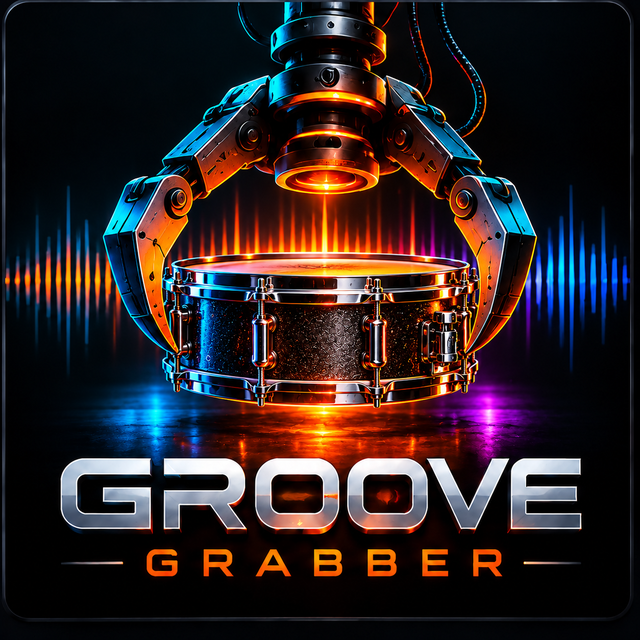

<p align="center"></p>

# Groove Grabber

**Your sounds. Your style. Your groove.** Describe the song you're making and Groove Grabber builds four drum kits
for it from the packs and one shots you already own. You get the kick, 808, snare, clap, rim, hats, toms, cymbals,
percussion and FX, tuned to your song's key and matched in level. Lock what you love, regenerate the rest,
then drop the kit straight onto Groove Agent.


| Format | Where it works |
|---|---|
| **VST3** | Cubase, Ableton Live, FL Studio, Studio One, Reaper, Bitwig... (Windows + Mac) |
| **AU** | Logic Pro, GarageBand, Ableton on Mac |
| **Standalone app** | Windows, Mac, Linux |
| **LV2** | Linux hosts |

---

## How you use it

1. **LIBRARY:** add the folders where your drum kits and one shots live (sub-folders count). Groove Grabber
   listens to every sound once: what it is (kick, 808, snare...), how it sounds (punch, warmth, brightness,
   room, vintage, aggression, live feel), its pitch, and whether it's clipped or hissy. It remembers everything,
   so after the first scan only new files are analysed. Scanning runs in the background on at most half your
   cores, so your session keeps playing.
2. **BUILD:** type what you're making, for example *"dark 90s boom bap, punchy but warm, vinyl vibe, 88 BPM in A minor"*,
   *"80s pop rock"*, *"like Dr. Dre"* or *"Metro Boomin type beat"*. The genre, style, decade, character sliders,
   tempo, key and options set themselves from it (it shows what it understood), and you can fine-tune them.
3. **GENERATE KITS:** four kits, each a different take on your style, named for it (90s G-Funk: *90s Westside
   Classic, 90s Sunset G-Funk, 90s Westside Knock, 90s G-Funk Machine*; Hard Rock: *Rock Hard Hitter, Arena Hard
   Rock...*). They're steered apart so they don't share their main sounds. Click a kit to hear it play a groove at
   your tempo. Every kit is level-matched, so a louder kit never wins just for being louder. Saved kits keep the name.
4. **Edit:** click any pad to hear it. **Lock** the ones you love and **REGENERATE** the rest. Every pad shows five
   **alternatives** that fit the rest of the kit; click one to hear it, **USE** to swap. TUNE / START / LENGTH /
   GAIN / REVERSE shape each pad. Drop any audio file on a pad to use it, or drag a pad into your DAW.
5. **EXPORT** for Groove Agent, then drag the kit onto pad 1 (see below).

**Kit chemistry.** Sounds aren't just picked one by one. The open hat comes from the same pack as the closed hat,
toms step apart in pitch, the percussion pads are different kinds (shaker, tambourine, conga...), the kick leaves
room for the 808, and the whole kit agrees on how vintage and roomy it is.

**Tuned to your key.** With a key set, the 808 lands on the root, the kick on the root or fifth (only when it's
close), and the toms on notes of the scale. The pad shows how far each one moved.

**Genres and styles:** Hip-Hop (East Coast / Boom Bap, West Coast / G-Funk, Memphis / Phonk, Southern / Crunk,
Old School / Electro), Trap (Atlanta, UK Drill, NY Drill, Rage, Plugg), R&B (90s / New Jack, Neo Soul, Alt R&B,
Funk / Motown), Pop (Synth Pop / 80s, Dance Pop, Pop Rock, Indie), Rock (Classic, Hard Rock, Metal, Alt / Grunge,
Punk), Country (Classic / Honky Tonk, Modern Nashville, Country Rap, Americana), Worship (Modern, Gospel, Ambient),
EDM (House, Techno, Drum & Bass, Dubstep, Disco), Lo-Fi (Jazz Hop, Lo-Fi Trap) and Cinematic (Trailer, Horror, World).
Each style has four directions, its own tempo and preview grooves. Mention a second genre ("...with a little trap")
and its character is blended in.

**Decades.** "60s" ... "90s", "2000s", "2010s", "today" move all four kits toward that decade's sound (80s: gated
rooms and drum machines; 70s: dry, warm, live) and, with just a genre, pick the style the decade is known for
("80s pop" -> Synth Pop / 80s, "90s r&b" -> New Jack).

**Artists and songs.** Name one: *"like Dr. Dre"*, *"Still D.R.E."*, *"Bon Jovi drums"*, *"Morgan Wallen"*,
*"Kirk Franklin"*. Hundreds of artists and producers and about 90 songs across every genre are built in; each maps to the style, decade
and character its drums are known for, and kit 1 becomes that artist's own direction (Dr. Dre -> 90s West Coast,
kit 1 *Westside Knock*). The genre you pick decides which side of an artist you get (Post Malone: trap, pop, country
or rock); an artist from another genre lends their decade and feel ("Dr. Dre" on Rock: 90s alt rock with a little
hip-hop). Names that are also ordinary words need a cue: *"like Future"*, *"Prince type beat"*. Nothing is
downloaded: Groove Grabber matches names to sounds you already have. For a song's actual drums, drop the song on
LIBRARY > HARVEST.

## Groove Agent

**EXPORT** writes a folder:

```
90s Westside Classic/
  01 Kick.wav  02 Rim.wav  03 Snare.wav  04 Clap.wav  05 Snare 2.wav ... 17 808.wav ... 22 FX 2.wav
  90s Westside Classic.pgm          MPC 1000 program with every pad and note set
  90s Westside Classic Groove.mid   the preview groove on the same notes
  Kit Info.txt                      where every sound came from + the loading steps
  90s Westside Classic.ggkit        open it again in Groove Grabber
```

The WAVs are numbered in **General MIDI order from C1 (note 36)**, already trimmed, tuned and level-matched.
Empty pads get a silent file, so the numbering never shifts.

1. In the export panel, grab **DRAG TO GROOVE AGENT** and drop it on Groove Agent's **first pad (C1)**. All the
   pads fill in order, so every sound lands on its GM note and Groove Agent's own grooves play the right drums.
   You can also select the numbered files in the folder and drop those.
2. Optional: put Closed Hat, Pedal Hat and Open Hat (pads 7, 9, 11) in one Exclusive Group.
3. Right-click the kit > **Export Kit with Samples**, so it's a normal Groove Agent kit from then on.

Groove Agent can also import the `.pgm` (right-click the kit slot > Import). The pad layout is 36 Kick, 37 Rim,
38 Snare, 39 Clap, 40 Snare 2, 41/43 Floor Toms, 42 Closed Hat, 44 Pedal Hat, 45/47 Low/Mid Tom, 46 Open Hat,
48/50 Hi-Mid/High Tom, 49 Crash, 51 Ride, 52 808, 53-55 Perc, 56-57 FX.

Groove Agent's own factory sounds are copy-protected and can't be read by other programs. To use some of them,
bounce a "sampling pass" (each drum hit on its own at soft, medium and hard) and drop it in **HARVEST HITS**.

## Works with your other plug-ins

* **Key Compass:** the KEY COMPASS button lists the songs in Key Compass's *My Songs* and takes their key and tempo.
  If a song has no key set, the key comes from its chords.
* **Sample Snagger:** its sample library is picked up automatically as a source. Split a full mix into stems there,
  then drop the drum stem into Groove Grabber's **HARVEST HITS**.
* **HARVEST HITS** (LIBRARY page): drop a drums-only bounce, a drum stem or a break. Every hit is found and
  classified, hits of the same drum are grouped, and the cleanest **soft / medium / hard** versions of each are kept.
* No Key Compass song? KEY COMPASS > *Detect key and tempo from a song file* reads them from a bounce of your song.
* Click the logo to switch between dark and light. The gear holds audio / MIDI settings (app) and the export format.

## In the DAW

Groove Grabber is an instrument. On an instrument track it plays the selected kit from MIDI (the same GM notes as
the export), so you can try a kit with your own drum part. **Follow DAW** locks the preview groove to your
timeline while the DAW plays, so you hear the kit inside your song. Everything is saved with the project.
Playback costs almost nothing: every pad is pre-rendered.


## Building

Needs CMake 3.24+ and a C++20 compiler (Visual Studio 2022, Xcode 15+, GCC 11+). JUCE is fetched automatically.

```
cmake -B build -DCMAKE_BUILD_TYPE=Release
cmake --build build --config Release
```

GitHub Actions builds Windows, macOS (universal) and Linux on every push, runs the tests and makes installers.
Put `[release]` in a commit message (or push a `v*` tag) to publish them as a release.

**Tests:** `GGTests` synthesises a drum library and checks the analysis and classification (by name and by sound),
descriptions, Key Compass songs, kit generation (directions, locks, key tuning), export (file order, MPC program,
MIDI), the sound engine, harvesting and song tempo / key. It then draws every page in dark and light to PNGs
(`--engine` skips the screenshots).

| Folder | |
|---|---|
| `Source/core` | analysis, library, styles, kit generator, rendering, player, export, harvester (no UI) |
| `Source/ui` | theme, widgets, pages |
| `Tests` | the test runner and test sound synthesiser |
| `packaging` | Windows (Inno Setup), macOS (pkg) and Linux installers |

Credits: [JUCE](https://juce.com); fonts Orbitron and Rajdhani (SIL OFL); the empty MPC program template from
[pympc1000](https://github.com/stephenn/pympc1000) (zlib). Groove Grabber ships no sounds: every kit comes from your
own library, so check each pack's licence before releasing music made with it.
